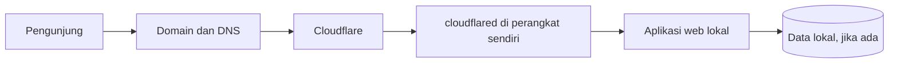

# Publikasi Web Tanpa VPS dengan Cloudflare Tunnel dan Domain Sendiri


## Hasil belajar

Setelah mengikuti materi ini, peserta dapat:

1. Menjelaskan perbedaan domain, DNS, hosting, dan tunnel.
2. Membuka aplikasi lokal ke internet tanpa menyewa VPS atau membuka port router.
3. Membeli domain dan mengarahkan hostname ke Cloudflare Tunnel.
4. Memeriksa aplikasi dari luar jaringan dan mendiagnosis masalah umum.

> **Inti pilihan:** untuk aplikasi yang tetap berjalan di perangkat sendiri, gunakan **Cloudflare Tunnel**. Vercel menyediakan hosting dan domain, tetapi bukan pengganti langsung tunnel dari internet ke aplikasi yang tetap hidup di PC rumah. [Cloudflare Tunnel](https://developers.cloudflare.com/tunnel/get-started/), [Vercel Deployments](https://vercel.com/docs/deployments/overview).

## 1. Peta konsep



| Istilah | Artinya | Contoh |
| --- | --- | --- |
| Aplikasi lokal | Web yang sudah berjalan di perangkat Anda | `http://localhost:8080` |
| Domain | Nama yang diingat pengunjung | `app.contoh-domain.id` |
| DNS | Menghubungkan nama domain ke layanan | Record untuk hostname `app` |
| `cloudflared` | Program yang membuat koneksi keluar dari perangkat ke Cloudflare | Berjalan sebagai service atau container |
| Tunnel | Jalur Cloudflare ke aplikasi lokal | Hostname publik → service URL lokal |

Cloudflare Tunnel membuat koneksi **keluar** dari perangkat Anda. Untuk web HTTP/HTTPS biasa, Anda tidak perlu mengatur port forwarding router atau IP publik. Perangkat dan aplikasi tetap harus menyala serta mempunyai internet. [Dokumentasi Cloudflare](https://developers.cloudflare.com/tunnel/get-started/).

## 2. Pilih perangkat asal

| Perangkat | Cocok untuk | Hal yang perlu disiapkan |
| --- | --- | --- |
| Laptop/PC | Belajar, demo, atau penggunaan saat komputer aktif | Matikan mode sleep ketika situs harus tersedia |
| Mini PC/Raspberry Pi | Situs kecil yang harus sering tersedia | Daya, jaringan, dan pemantauan proses |
| NAS | Aplikasi yang memakai data pada NAS | Pastikan aplikasi dan tunnel berjalan sebagai layanan |

**Tidak perlu VPS**, tetapi ini bukan hosting tanpa komputer: listrik dan koneksi internet perangkat asal tetap menjadi tanggung jawab Anda. Jika perangkat dimatikan, pengunjung tidak bisa membuka aplikasinya.


1. create tunnel
 - download cloudflare-windows

2. klo sudah punya cloudflare yg aktif
```
cloudflared.exe service uninstall
```
2. install ulang

contoh:
```
cloudflared.exe service install eyJhIjoiYzU4YmU3Mzg5ODdlZThhOGMwNDlmOGU3MjJjOTYxZDUiLCJ0IjoiOTBiZTJlMWItMzY2MC00OGVjLWExNDktM2JiNzRkOGNiNjFhIiwicyI6Ik5UZzFOR0psWldZdE1qTXdPUzAwWVRBMkxXRXlZakF0T0RVM1l6QmtORFl4TmpJeCJ9
```
continue

3. jalankan localhost
```
cloudflared.exe tunnel --url http://127.0.0.1:8088
```
## 4. Beli domain

1. Pilih nama dan ekstensi, misalnya `contoh-domain.id` atau `contoh-domain.com`.
2. Cari ketersediaan di registrar yang mendukung ekstensi tersebut. Bisa melalui registrar lokal, Cloudflare Registrar bila ekstensinya tersedia, atau penyedia domain lain. Tidak perlu memindahkan aplikasi ke registrar tempat domain dibeli.
3. Bandingkan **harga tahun pertama, harga perpanjangan, pajak, dan syarat registrasi** pada halaman checkout. Harga dan ketersediaan berubah; jangan mengandalkan angka dalam slide lama.
4. Daftar dengan identitas dan email yang Anda kuasai, selesaikan pembayaran, lalu verifikasi email registran bila diminta.
5. Simpan akses registrar dan aktifkan perpanjangan otomatis jika ingin menghindari domain kedaluwarsa.

Cloudflare Registrar hanya menampilkan ekstensi yang didukung. Bila ekstensi yang Anda inginkan tidak tersedia di sana, beli di registrar lain lalu gunakan Cloudflare sebagai DNS. [Cloudflare Registrar](https://developers.cloudflare.com/registrar/get-started/register-domain/), [daftar dukungan TLD](https://developers.cloudflare.com/registrar/top-level-domains/).

**Latihan keputusan:** tulis nama domain pilihan, harga tahun pertama, harga perpanjangan, dan registrar. Jangan melakukan pembelian hanya berdasarkan harga promosi pertama.

## 5. Arahkan domain ke Cloudflare DNS

Langkah ini berlaku jika domain dibeli di registrar lain. Jika dibeli melalui Cloudflare Registrar, domain sudah menggunakan nameserver Cloudflare. [Cloudflare Registrar](https://developers.cloudflare.com/registrar/get-started/register-domain/).

1. Tambahkan domain ke akun Cloudflare melalui **Add a domain / Add site**.
2. Tinjau record DNS yang diimpor, terutama record email seperti MX dan TXT. Jika domain baru, biasanya belum ada record yang perlu dipertahankan.
3. Cloudflare menampilkan dua **nameserver** untuk domain Anda. Salin nama yang diberikan akun Anda; jangan menyalin nameserver dari tutorial orang lain.
4. Di panel registrar tempat membeli domain, ganti nameserver lama dengan dua nameserver tersebut.
5. Tunggu sampai status domain di Cloudflare aktif. Setelah delegasi nameserver selesai, perubahan DNS dikelola di Cloudflare.

Perubahan nameserver dapat memerlukan waktu untuk tersebar. Record email yang hilang dapat mengganggu email domain. [Panduan Cloudflare DNS](https://developers.cloudflare.com/dns/get-started/).

## 6. Buat named tunnel dan hostname publik

1. Buka dashboard Cloudflare → **Networking → Tunnels** → buat tunnel baru bertipe `cloudflared`.
2. Beri nama tunnel, misalnya `web-rumah`.
3. Pasang dan jalankan `cloudflared` di **perangkat yang bisa mengakses aplikasi**. Ikuti perintah pemasangan yang ditampilkan dashboard untuk Windows, Linux, macOS, atau Docker. Token tunnel bersifat rahasia; jangan masukkan ke slide, tangkapan layar publik, atau Git.
4. Di tunnel tersebut, buka **Routes → Add route → Published application**.
5. Pilih hostname, misalnya `app.contoh-domain.id`, lalu isi **Service URL** sesuai lokasi aplikasi:

   | Posisi `cloudflared` | Contoh Service URL |
   | --- | --- |
   | Satu komputer dengan aplikasi port 8080 | `http://localhost:8080` |
   | Docker Compose yang sama, service aplikasi bernama `web` port 80 | `http://web:80` |
   | Perangkat lain dalam LAN | `http://192.168.1.50:8080` |

6. Simpan route dan periksa record hostname yang dibuat/diarahkan ke tunnel. Cloudflare menggunakan target tunnel seperti `<ID-TUNNEL>.cfargotunnel.com`; gunakan nilai dari dashboard Anda. [Panduan pemasangan tunnel](https://developers.cloudflare.com/tunnel/get-started/), [published applications](https://developers.cloudflare.com/cloudflare-one/networks/connectors/cloudflare-tunnel/routing-to-tunnel/).

**Mengapa `localhost` kadang gagal?** Di dalam container Docker, `localhost` menunjuk container itu sendiri. Jika aplikasi berada di container lain pada jaringan Compose yang sama, gunakan nama service dan port internalnya, misalnya `http://web:80`.

### Praktik Docker siap pakai

Folder [contoh-cloudflare](./contoh-cloudflare/) menyediakan situs HTML sederhana. `compose.yml` menjalankan web lokal; `compose.tunnel.yml` menambahkan `cloudflared` setelah token tersedia. Ini dapat dipakai di PC, mini PC, atau NAS yang memiliki Docker; VPS **tidak diperlukan**.

```bash
cd contoh-cloudflare
docker compose up -d
docker compose ps
# Buka http://localhost:8088 untuk memastikan web lokal berhasil.
```

Setelah mempunyai named tunnel dan token:

```bash
cp .env.example .env
# Isi TUNNEL_TOKEN di .env dengan token dari dashboard Cloudflare.
docker compose -f compose.yml -f compose.tunnel.yml up -d
```

Di PowerShell Windows, ganti baris `cp` dengan `Copy-Item .env.example .env`.

Sebelum memasang tunnel, web demo dapat diuji di `http://localhost:8088`. Pada route tunnel, isi Service URL `http://web:80`. Simpan `.env` hanya di perangkat Anda.

### Tanpa Docker

Jalankan aplikasi terlebih dahulu, lalu gunakan pemasangan `cloudflared` untuk sistem operasi Anda dari dashboard tunnel. Cloudflare menyediakan perintah pemasangan sebagai service untuk Windows, Linux, dan macOS. Pilih Service URL `http://localhost:PORT` jika aplikasi dan `cloudflared` berjalan di komputer yang sama. [Panduan resmi](https://developers.cloudflare.com/tunnel/get-started/).

## 7. Verifikasi dari luar jaringan

Gunakan ponsel dengan data seluler, bukan hanya Wi-Fi yang sama, lalu buka hostname publik. Untuk aplikasi yang menyediakan endpoint kesehatan, uji juga endpoint itu.

```bash
curl -I https://app.contoh-domain.id/
```

Hasil yang dicari: halaman muncul, HTTPS aktif, dan aplikasi dapat digunakan. Browser mungkin menampilkan `200`, `301`, atau `302` tergantung aplikasi; yang penting respons sesuai rancangan. Pengujian URL saja belum memastikan database atau fitur login bekerja.

### Jika muncul 502 Bad Gateway

Periksa berurutan:

1. Aplikasi lokal masih merespons? `curl -i http://localhost:8080/` atau URL lokal yang benar.
2. `cloudflared` berjalan? Lihat status tunnel serta log proses/container.
3. Service URL pada route cocok dengan **protokol, nama host, dan port** aplikasi?
4. Jika memakai Docker, apakah kedua service ada dalam jaringan Compose yang sama dan nama service benar?
5. Jika aplikasi memakai database atau folder data, lihat log dan readiness aplikasi.

Tunnel yang terlihat *Healthy* hanya membuktikan konektor terhubung ke Cloudflare; aplikasi di belakangnya tetap bisa gagal. Cloudflare menjelaskan 502 tunnel sebagai masalah ketika `cloudflared` tidak dapat mencapai service asal. [Troubleshooting Cloudflare Tunnel](https://developers.cloudflare.com/tunnel/troubleshooting/).

## 8. Keamanan minimum

- Simpan token tunnel dan password aplikasi di secret manager atau file `.env` yang tidak diunggah ke Git. Siapa pun yang memiliki token tunnel dapat menjalankan konektor untuk tunnel itu. [Cloudflare: tunnel tokens](https://developers.cloudflare.com/tunnel/reference/tunnel-tokens/).
- Aktifkan autentikasi pada aplikasi yang menyimpan data pribadi. Tunnel hanya membuat jalur akses; otorisasi pengguna tetap tugas aplikasi atau kebijakan Cloudflare Access.
- Jangan membuka panel admin router, Docker, atau NAS ke internet hanya karena aplikasi web perlu dipublikasikan.
- Lakukan backup data aplikasi dan simpan akses registrar, Cloudflare, serta perangkat asal.

## 9. Cloudflare Tunnel atau Vercel?

| Kebutuhan | Pilihan yang pas |
| --- | --- |
| Web dan database tetap hidup di perangkat sendiri | Cloudflare Tunnel + domain |
| Web statis/React ingin di-host dari Git tanpa komputer selalu menyala | Vercel + domain |
| Frontend di Vercel, API tetap di rumah | Perlu rancangan dua layanan dan pengaturan API, autentikasi, serta DNS; bukan langkah awal paling sederhana |

Vercel membuat deployment dari Git/CLI dan memberikan URL `*.vercel.app`. Domain sendiri dapat dibeli di Vercel atau registrar lain, lalu ditambahkan ke proyek dan diverifikasi sesuai record DNS yang ditampilkan proyek. Jika DNS dikelola Cloudflare, record dibuat di Cloudflare, bukan lewat panel DNS Vercel. [Vercel deployment](https://vercel.com/docs/deployments/overview), [domain kustom](https://vercel.com/docs/domains/set-up-custom-domain), [membeli domain](https://vercel.com/docs/domains/working-with-domains).

**Untuk tujuan materi ini—tanpa VPS dan aplikasi tetap di perangkat sendiri—ikuti jalur Cloudflare Tunnel.** Vercel dapat menjadi topik lanjutan untuk aplikasi yang memang akan dipindahkan ke hosting Vercel.

## 10. Studi kasus Salnova

Salnova berjalan di NAS lewat Docker. Domain publik menuju Cloudflare Tunnel, lalu `cloudflared` meneruskan permintaan ke service aplikasi pada jaringan Docker. Prinsipnya sama jika aplikasi dipindah ke PC atau mini PC: yang berubah hanya perangkat asal dan Service URL. Token serta password produksi tidak diperlukan untuk mempelajari alurnya.

Ketika Salnova sempat menampilkan 502, tunnel masih berjalan tetapi aplikasi tidak mengembalikan respons. Setelah container aplikasi di-restart, endpoint `/api/ready` kembali melaporkan database dan penyimpanan sehat. Ini contoh mengapa pemeriksaan harus dilakukan dari **URL publik sampai aplikasi dan data**, bukan hanya melihat status tunnel.

## Tugas praktik

1. Jalankan web demo dan tunjukkan bahwa `http://localhost:8088` dapat dibuka.
2. Coba Quick Tunnel tanpa domain. Jika melanjutkan ke named tunnel, gunakan route `http://localhost:8088` untuk server Python di PC atau `http://web:80` untuk demo Docker.
3. Buka hostname publik memakai data seluler.
4. Jelaskan apa yang terjadi bila perangkat asal dimatikan.
5. Catat harga registrasi dan perpanjangan satu domain pilihan. Pembelian sungguhan tidak wajib untuk latihan pertama; gunakan Quick Tunnel jika belum memiliki domain.

## Rujukan utama

- [Cloudflare: Set up Tunnel](https://developers.cloudflare.com/tunnel/get-started/)
- [Cloudflare: Quick Tunnel tanpa domain](https://developers.cloudflare.com/tunnel/get-started/quick-tunnels/)
- [Cloudflare: Tunnel tokens](https://developers.cloudflare.com/tunnel/reference/tunnel-tokens/)
- [Cloudflare: Published applications](https://developers.cloudflare.com/cloudflare-one/networks/connectors/cloudflare-tunnel/routing-to-tunnel/)
- [Cloudflare: DNS setup](https://developers.cloudflare.com/dns/get-started/)
- [Cloudflare: Tunnel troubleshooting](https://developers.cloudflare.com/tunnel/troubleshooting/)
- [Cloudflare Registrar: Register a domain](https://developers.cloudflare.com/registrar/get-started/register-domain/)
- [Vercel: Deployments](https://vercel.com/docs/deployments/overview)
- [Vercel: Custom domain](https://vercel.com/docs/domains/set-up-custom-domain)
